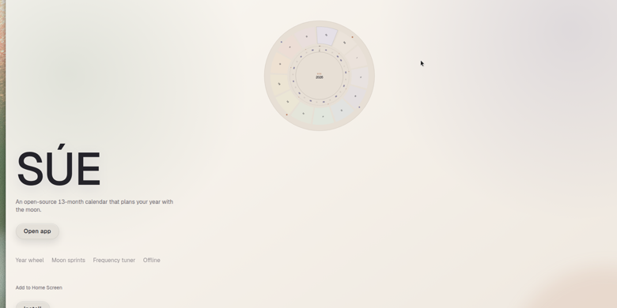
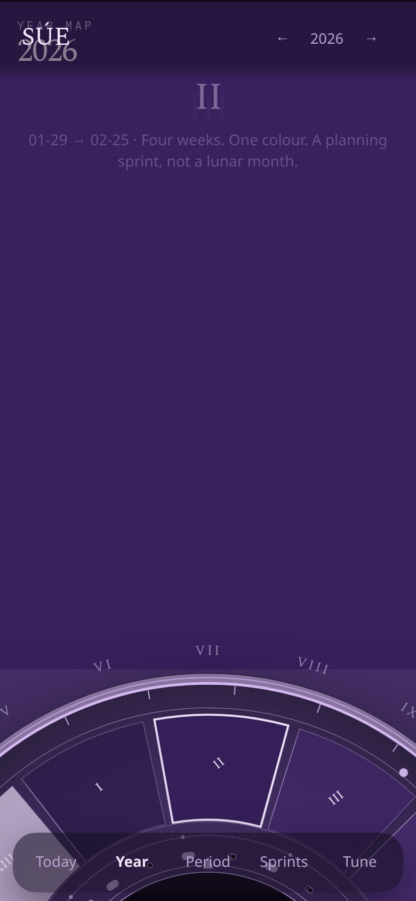
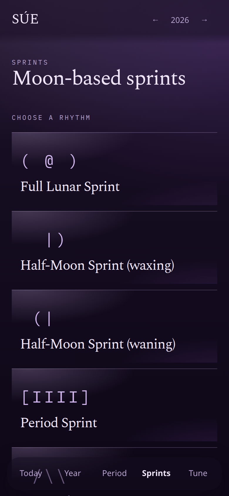
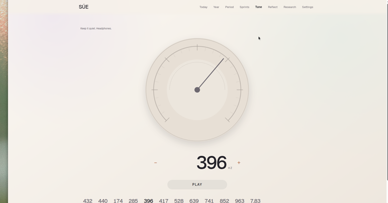
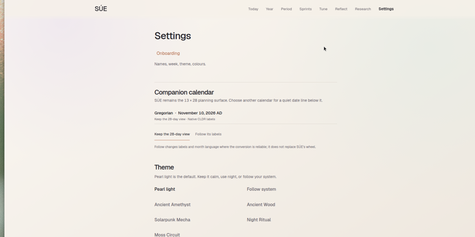
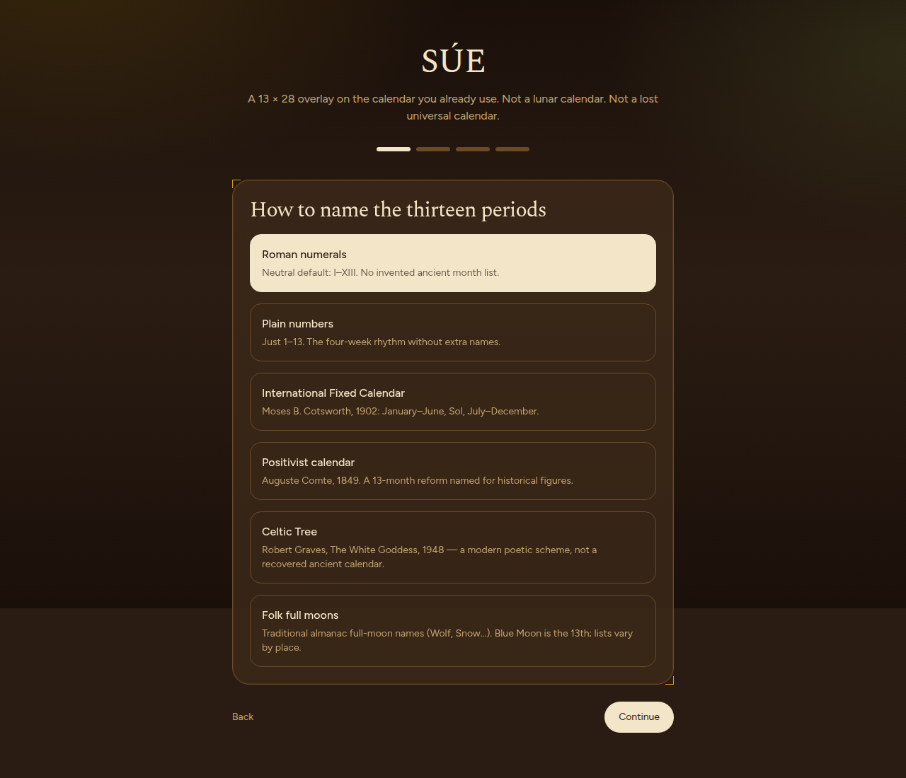
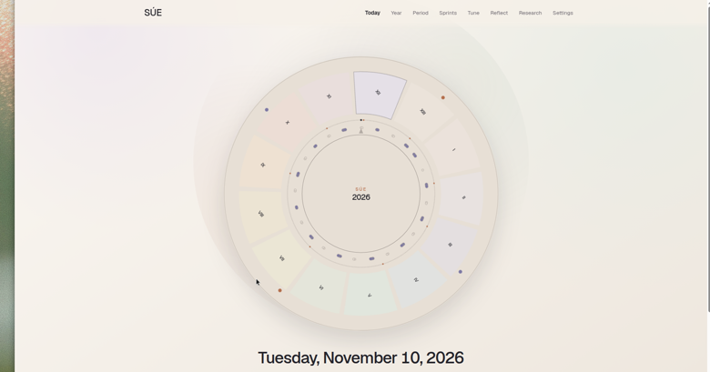

<p align="center">
  
</p>

# SÚE

An open-source 13-month calendar that plans your year with the moon, in a calm
light-by-default interface.

**[Live demo](#)** — *URL coming soon.*

## Features

- **Year wheel** — scroll, drag, or flick. The page blends into the period colour. Tap a day to open it; tap the hub for today.

  

- **Moon sprints** — tiles, not dropdowns. Push / light / rest as a rhythm, not science.

  

- **Frequency tuner** — a rotary dial, waveforms, optional binaural beats. Hertz is physics; assigned meanings are tradition.

  

- **Themes** — Pearl light (default), Follow system, or one of the dark skins:
  Ancient Amethyst, Ancient Wood, Solarpunk Mecha, Night Ritual, and Moss Circuit.

  

- **Naming presets** — Roman I–XIII, numbers, IFC, Comte, Graves 1948, folk moons, or your 13.

  

- **Home** — today, after you open or install the app.

  

Works with **zero accounts**. Google, Apple, and `.ics` are optional. Onboarding can be skipped — Roman names, Sunday = −1, Pearl light. Reopen it from Settings.

## Quick start

```bash
npm install
npm run dev
```

Open [http://localhost:3000](http://localhost:3000). Then:

```bash
npm run test:calendar && npm run lint && npm run build
```

## How 13 × 28 works

Thirteen periods of 28 days = 364.

**Year Day** sits outside the periods. Leap years add **Leap Day** after period 6.

A synodic month is about 29.53 days — the moon is a layer on the year, not the period length. See Research for fact / calculation / interpretation labels.

## Install the app

**Web (PWA).** The site opens on a landing page. Chrome/Android can **Install**. iOS Safari: Share → Add to Home Screen. Installed and returning users go straight to `/app`. The service worker caches the local-first app. The `/api/caldav` proxy is not available offline.

**iOS / Android (Capacitor).**

```bash
npm run cap:ios       # macOS + Xcode
npm run cap:android   # Android Studio
```

Or build the static shell and sync:

```bash
npm run cap:sync
```

Native shells have **no** Next.js API routes. Point CalDAV at the deployed web origin:

```bash
NEXT_PUBLIC_CALDAV_URL=https://YOUR-VERCEL-URL/api/caldav
```

Then `npm run cap:sync` again. Status bar and haptics use Capacitor plugins; the web build falls back to `navigator.vibrate`.

Sergio still needs: an Apple Developer account + Xcode to ship iOS; Android Studio / a Play Console account to ship Android; a live Vercel URL for the demo link and native CalDAV.

<details>
<summary>Optional calendar sync</summary>

**Google** (read + write)

1. Create an OAuth 2.0 Web client in [Google Cloud Console](https://console.cloud.google.com/).
2. Enable the Google Calendar API.
3. Authorized JavaScript origins: `http://localhost:3000` and your deployed origin.
4. Put the client ID in `.env.local`:

```bash
NEXT_PUBLIC_GOOGLE_CLIENT_ID=your-client-id.apps.googleusercontent.com
```

Without a client ID, Google stays hidden.

**Apple / iCloud** (CalDAV)

1. Turn on 2FA. Create an [app-specific password](https://appleid.apple.com/).
2. In Settings, enter the Apple ID and that password.
3. The web app posts to `/api/caldav`. Credentials are **never stored on the server**.
4. Native / static-export builds use `NEXT_PUBLIC_CALDAV_URL` instead.

`.ics` import/export is the zero-proxy fallback.

</details>

## Contributing

See [CONTRIBUTING.md](./CONTRIBUTING.md) and [CODE_OF_CONDUCT.md](./CODE_OF_CONDUCT.md). PRs need `lint`, `test:calendar`, and `build` green (GitHub Actions runs them).

## License

[MIT](./LICENSE) · © Sergio Piñeros

## Credits

Sergio Piñeros — concept and design brief.

[Michal Ferber](https://github.com/MichalAFerber/frequency-tone-generator) — MIT Web Audio oscillator pattern used by the tuner. See [THIRD_PARTY.md](./THIRD_PARTY.md).

International Fixed Calendar (Moses B. Cotsworth) is a historical 13 × 28 scheme; SÚE is a planning layer on top, not a claim of lost antiquity.
